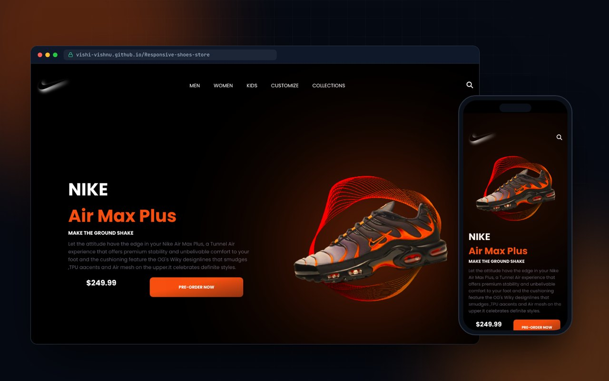
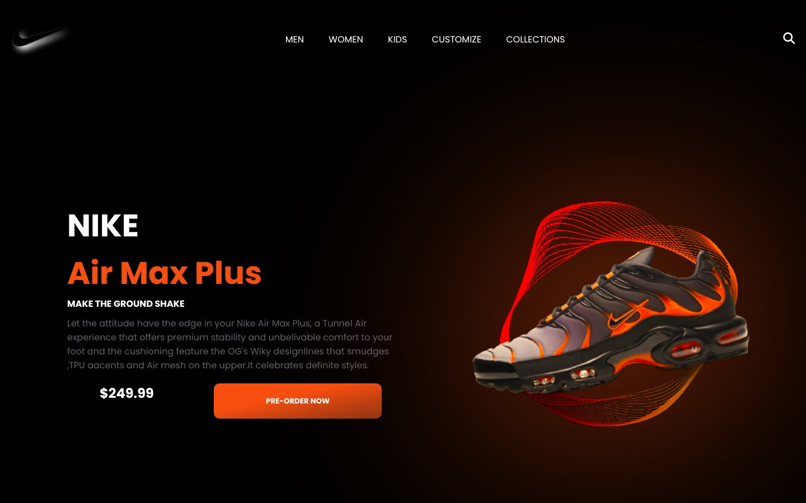

<div align="center">



# Responsive Shoe Store · Product Landing Page

**A bold, dark product landing page for a sneaker drop, with scroll animations powered by AOS.**


[**Live demo**](https://vishi-vishnu.github.io/Responsive-shoes-store/) &nbsp;·&nbsp; [Features](#features) &nbsp;·&nbsp; [Run locally](#run-locally)

</div>

---

## Overview

A single-screen product page for a sneaker launch. The goal was a premium, high-contrast look with motion that draws attention to the product and the call to action, while staying fully responsive.

## Features

- **Dark product showcase** with a glowing drop shadow around the shoe
- **Staggered AOS animations**: headline, subtitle, description, price and button animate in one after another
- **Animated nav links** with an underline that grows on hover
- **Gradient call-to-action** button with a glow on hover
- **Fluid typography** using CSS `clamp()` so headings scale smoothly
- **Responsive layout**: on tablets and phones the product image moves above the text and the nav links are hidden on small phones

## Screenshots

| Desktop | Mobile |
| --- | --- |
|  |  |

## Tech stack

| Area | Tools |
| --- | --- |
| Markup | HTML5 |
| Styling | CSS3 (Flexbox, `clamp()`, gradients, media queries) |
| Animation | AOS (Animate On Scroll) |
| Icons and fonts | Font Awesome, Google Fonts (Poppins) |
| Hosting | GitHub Pages |

## Run locally

No build step needed.

```bash
git clone https://github.com/vishi-vishnu/Responsive-shoes-store.git
cd Responsive-shoes-store
npx serve .        # or just open index.html in a browser
```

## Deployment

Hosted on **GitHub Pages** from the `main` branch. Every push to `main` updates the live site automatically.

## Changelog

- **Fix:** the mobile layout rule used `content` instead of `.content`, so it never applied. Phones now get the image above the text, proper side padding and a correctly sized product image.

---

<div align="center">

Built by **Vishnu Kumar G K** · [Portfolio](https://github.com/vishi-vishnu/portfolio) · [LinkedIn](https://www.linkedin.com/in/vishnu081/) · [GitHub](https://github.com/vishi-vishnu)

</div>
